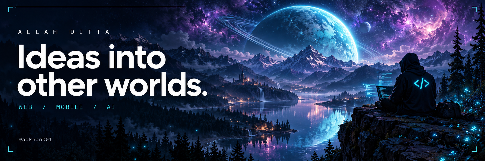
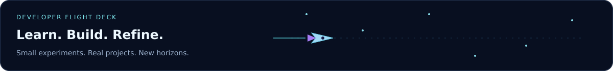
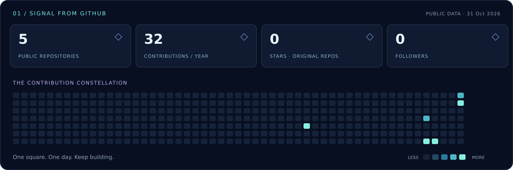
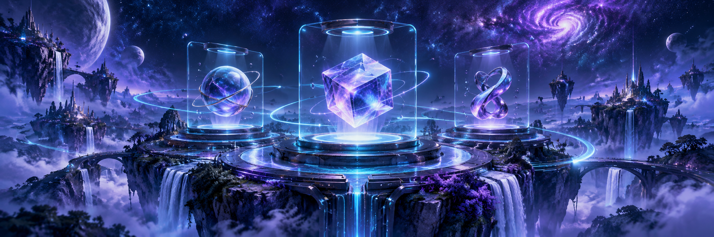
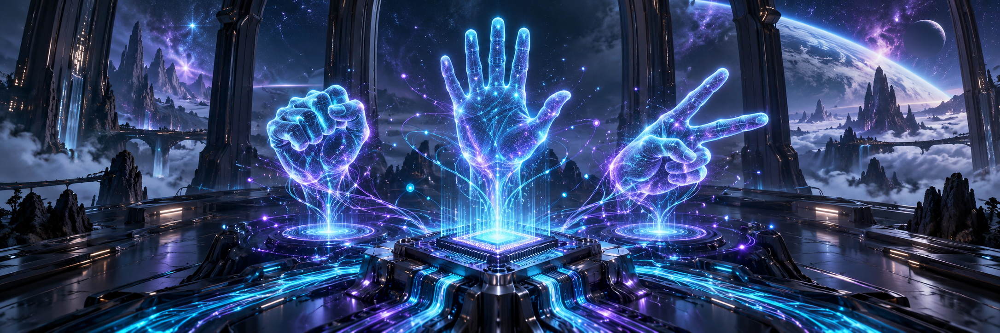
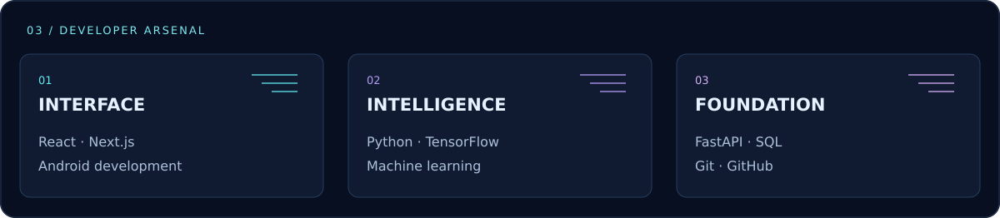
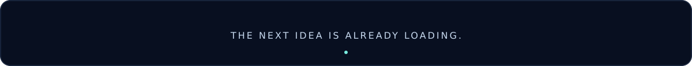

<p align="center">
  
</p>

<p align="center">
  <a href="https://github.com/adkhan001?tab=repositories"><strong>EXPLORE MY WORK</strong></a>
  &nbsp; ✦ &nbsp;
  <a href="#selected-missions"><strong>SELECTED MISSIONS</strong></a>
  &nbsp; ✦ &nbsp;
  <a href="#behind-the-builds"><strong>BEHIND THE BUILDS</strong></a>
</p>





### Selected missions

<table>
<tr>
<td width="50%" valign="top">
<a href="https://github.com/adkhan001/technest-store"></a>
<h3>01 · TechNest</h3>
<p>An online store project, connecting a product catalogue with a shopping experience.</p>
<p><code>WEB DEVELOPMENT</code> <code>HTML</code></p>
<a href="https://github.com/adkhan001/technest-store"><strong>Explore repository →</strong></a>
</td>
<td width="50%" valign="top">
<a href="https://github.com/adkhan001/Rock-Paper-Scissors-CNN"></a>
<h3>02 · Neural Gestures</h3>
<p>A convolutional neural network for classifying rock, paper, and scissors hand gestures.</p>
<p><code>TENSORFLOW</code> <code>KERAS</code> <code>CNN</code></p>
<a href="https://github.com/adkhan001/Rock-Paper-Scissors-CNN"><strong>Explore repository →</strong></a>
</td>
</tr>
</table>



### Behind the builds

I’m **Allah Ditta**, a Computer Science student exploring the space between useful software and imaginative experiences. I build across **web, mobile, and AI**, learning by turning ideas into working projects.

```typescript
const mission = {
  imagine: "Start with a real problem.",
  build:   "Make the first version work.",
  refine:  "Make the experience worth returning to."
};
```

<details>
<summary><strong>Open the mission log</strong></summary>

- I like interfaces that are clear, responsive, and considered.
- I explore machine learning through hands-on experiments.
- I use each project to strengthen the connection between design, code, and real use.

The illustrated project covers are concept art; source code is linked on each card. Statistics reflect public GitHub data and show their refresh date. GitHub controls the surrounding page layout and theme.

</details>


