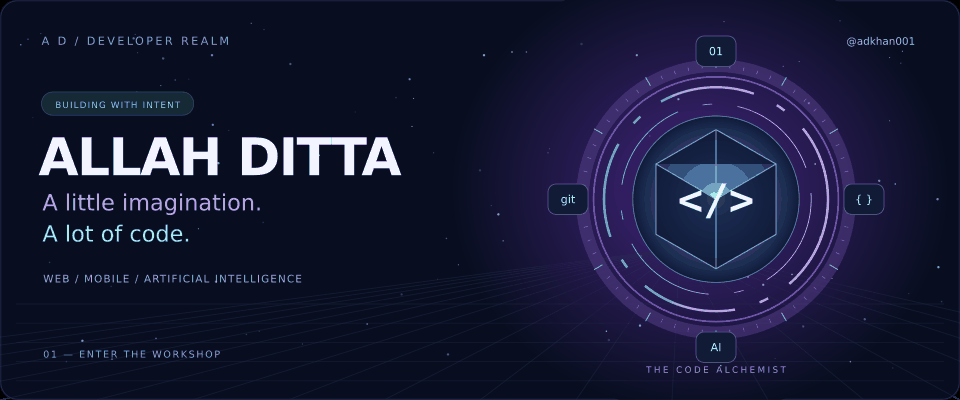
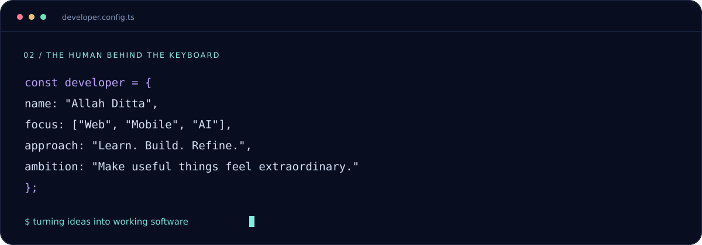
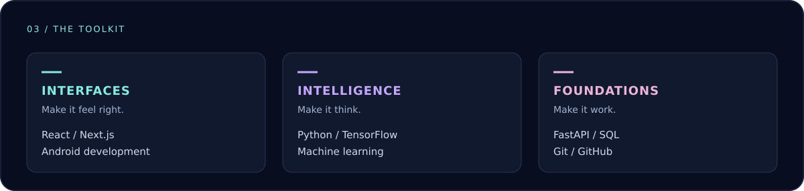
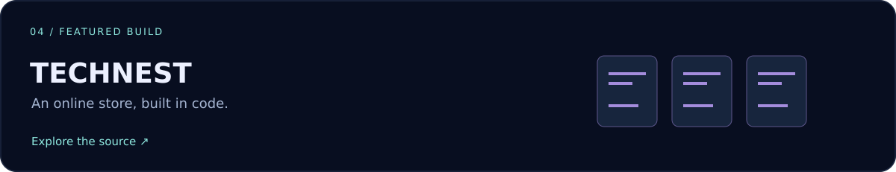

<p align="center">
  
</p>

<p align="center">
  <strong>Useful software. Thoughtful interfaces. A spark of imagination.</strong><br />
  I’m Allah Ditta, a Computer Science student building across web, mobile, and AI.
</p>

<p align="center">
  <a href="https://github.com/adkhan001?tab=repositories">Explore my repositories</a>
  &nbsp; · &nbsp;
  <a href="https://github.com/adkhan001/technest-store">Featured project</a>
</p>



### Building with purpose

I enjoy taking an idea from an early sketch to a working product—connecting the interface, application logic, and data into something people can use.

- **Web:** clear interfaces and practical applications.
- **Mobile:** turning everyday workflows into app experiences.
- **AI:** exploring machine learning through hands-on projects.



<a href="https://github.com/adkhan001/technest-store"></a>

<details>
<summary><strong>Open the developer’s field notes</strong></summary>

```typescript
while (curiosity) {
  const idea = explore();
  const prototype = build(idea);
  learnFrom(prototype);
  refine();
}
```

Good software starts with a real problem. The interesting part is finding a clear, useful way to solve it.

</details>

---

<p align="center"><sub>IMAGINATION → CODE → SOMETHING REAL</sub><br /><strong>Thanks for stepping into my corner of GitHub.</strong></p>
